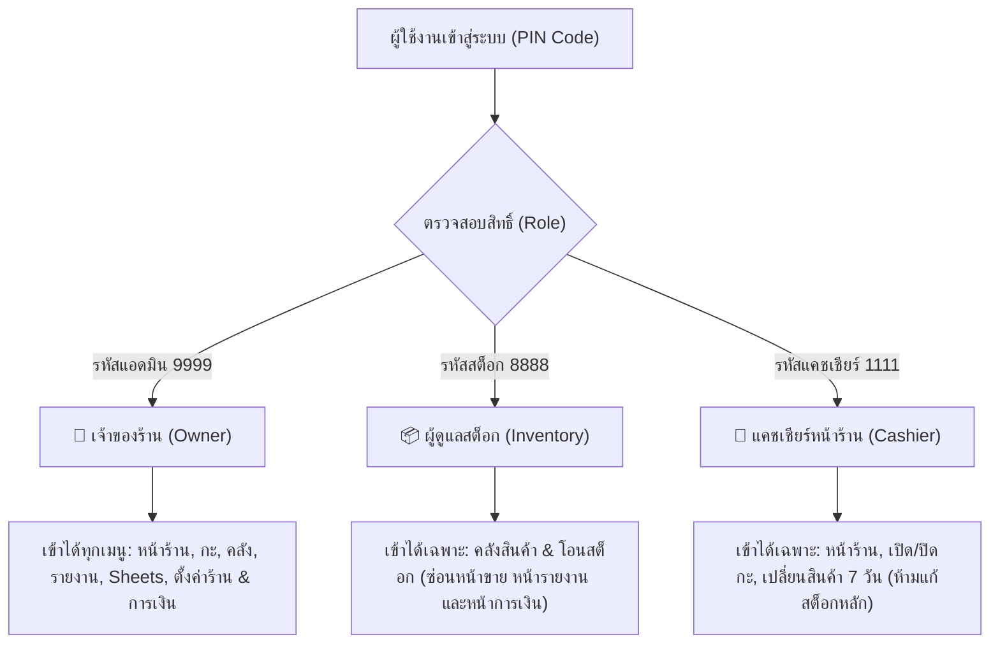
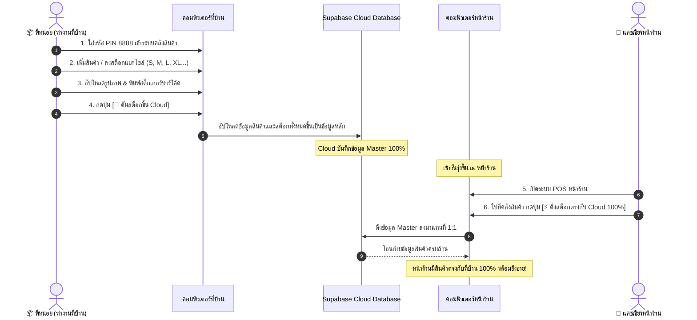
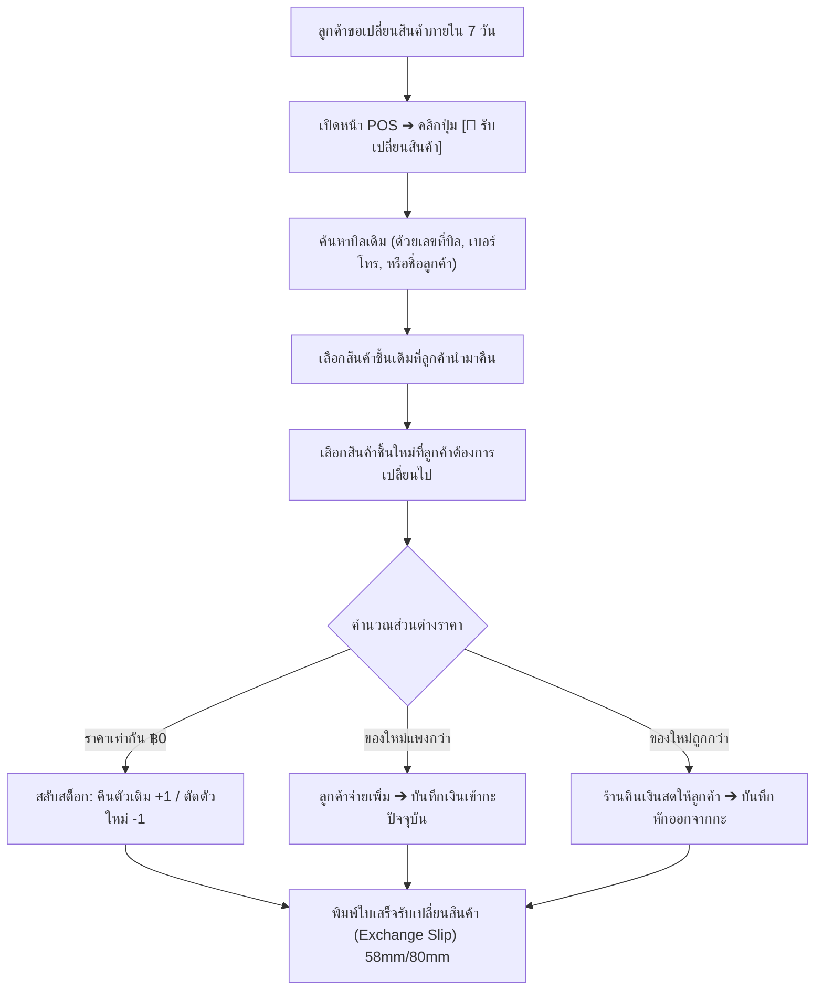
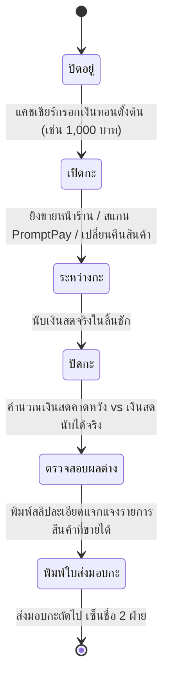
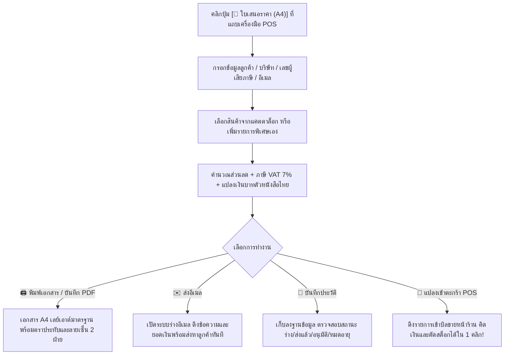

# คู่มือการใช้งานระบบ POS Korat Cat x เรือนโคราชเฉลิมวัฒนา
*(Haute Couture & Heritage Craft Boutique - Complete Operation Manual)*
**ฉบับสมบูรณ์ 100% ครบทุกฟังก์ชัน แยกหมวดหมู่อย่างละเอียด (Handbook Edition)**

---

## 📖 สารบัญเล่มคู่มือ (Table of Contents)

- [หมวดที่ 1: ภาพรวมระบบ สถาปัตยกรรม และสิทธิ์การใช้งาน (System & Roles)](#หมวดที่-1-ภาพรวมระบบ-สถาปัตยกรรม-และสิทธิ์การใช้งาน)
  - 1.1 สถาปัตยกรรม Offline-First + Cloud Hybrid (ข้อมูลไม่มีวันหาย)
  - 1.2 การแบ่งแยกหน้าที่และสิทธิ์การเข้าถึง (Role-Based Access Control)
  - 1.3 การจัดการรหัส PIN และความปลอดภัย
- [หมวดที่ 2: การจัดการคลังสินค้า สต็อก 2 จุด และป้ายแท็กบาร์โค้ด (Inventory & Barcodes)](#หมวดที่-2-การจัดการคลังสินค้า-สต็อก-2-จุด-และป้ายแท็กบาร์โค้ด)
  - 2.1 โครงสร้างสต็อก 2 คลัง (โกดัง/โรงงานผลิต vs หน้าร้านเรือนโคราช)
  - 2.2 การเพิ่มสินค้าใหม่แยกตามไซส์ (S, M, L, XL, 2XL)
  - 2.3 การสร้างสินค้าแบบ Matrix Generator (สี, ไซส์, เทคนิค DTF/Flex)
  - 2.4 การอัปโหลดรูปภาพจากมือถือพร้อมระบบบีบอัดอัตโนมัติ
  - 2.5 การพิมพ์ป้ายห้อยสินค้าพรีเมียม (45x70 mm Pure Vector Barcode)
  - 2.6 การเติมสต็อกสินค้าเดิม (Restock) & หลักการสำคัญเรื่องบาร์โค้ด
- [หมวดที่ 3: คู่มือการปฏิบัติงานสำหรับผู้ดูแลสต็อก (พี่หน่อย SOP - จากบ้านสู่ร้าน)](#หมวดที่-3-คู่มือการปฏิบัติงานสำหรับผู้ดูแลสต็อก-พี่หน่อย-sop---จากบ้านสู่ร้าน)
  - 3.1 ขั้นตอนการลงสต็อก/สร้างสินค้าใหม่ที่คอมพิวเตอร์ที่บ้าน
  - 3.2 ขั้นตอนสำคัญ: การกด "🚀 ดันสต็อกขึ้น Cloud" เพื่อเซฟเป็นข้อมูลหลัก
  - 3.3 ขั้นตอนการเปิดคอมพิวเตอร์หน้าร้าน: การกด "⚡ ดึงสต็อกตรงกับ Cloud 100%"
  - 3.4 การลบสินค้าและระบบป้องกันสินค้าผี (Tombstone Synchronization)
- [หมวดที่ 4: การขายหน้าร้าน & ระบบตัดสต็อกอัตโนมัติ (POS Terminal Operations)](#หมวดที่-4-การขายหน้าร้าน--ระบบตัดสต็อกอัตโนมัติ)
  - 4.1 ระบบตรวจสอบสต็อกสดก่อนเพิ่มลงบิล
  - 4.2 การบล็อกสินค้าหมดสต็อก (0 ชิ้น) และการเตือนเมื่อขายเกินจำนวน
  - 4.3 กลไกการตัดสต็อกเมื่อคิดเงินเสร็จสิ้น
  - 4.4 การสแกนบาร์โค้ดด้วยระบบ Smart Barcode Listener (แก้ภาษาไทยค้างอัตโนมัติ)
  - 4.5 การพักบิล (F6) และเรียกคืนบิล (F8)
  - 4.6 การขายสินค้ากำหนดราคาเอง / ค่าบริการพิเศษ (F7)
  - 4.7 ช่องทางการขาย (หน้าร้าน vs TikTok, Shopee, Lazada, LINE) และการตัดสต็อกแพ็คพัสดุ
- [หมวดที่ 5: ระบบการเปลี่ยนสินค้าและคืนสินค้าภายใน 7 วัน (Product Exchange & Return)](#หมวดที่-5-ระบบการเปลี่ยนสินค้าและคืนสินค้าภายใน-7-วัน)
  - 5.1 เงื่อนไขการเปลี่ยนคืนสินค้าตามนโยบายร้าน
  - 5.2 ขั้นตอนการค้นหาบิลเดิมของลูกค้า
  - 5.3 การสลับสต็อก: คืนตัวเก่า (+1 ชิ้น) และตัดตัวใหม่ (-1 ชิ้น)
  - 5.4 การคำนวณส่วนต่างราคา และผลกระทบต่อเงินในกะ
  - 5.5 การพิมพ์ใบเสร็จรับเปลี่ยนสินค้า (Exchange Slip)
- [หมวดที่ 6: การโอนย้ายสต็อกข้ามคลัง 2 ทิศทาง (Two-Way Stock Transfers)](#หมวดที่-6-การโอนย้ายสต็อกข้ามคลัง-2-ทิศทาง)
  - 6.1 โอนจากโกดัง ➔ หน้าร้าน (เติมสินค้าขาย)
  - 6.2 โอนจากหน้าร้าน ➔ ส่งคืนโกดัง (ส่งคืนสินค้าชำรุด/ปรับยอด)
  - 6.3 แถบแจ้งเตือนสีทองเด่นชัดสำหรับสาขาปลายทาง
  - 6.4 การกดตรวจรับสินค้าเข้าสต็อก (Pending Receipt ➔ Completed)
- [หมวดที่ 7: วงจรกะแคชเชียร์และใบส่งมอบกะฉบับละเอียด (Shift Operations & Handover)](#หมวดที่-7-วงจรกะแคชเชียร์และใบส่งมอบกะฉบับละเอียด)
  - 7.1 การเปิดกะหน้าร้านและการระบุเงินทอนตั้งต้น
  - 7.2 การคิดเงินแยกบัญชี เงินสด vs PromptPay QR Code
  - 7.3 การปิดกะและการตรวจนับเงินสดในลิ้นชัก (Reconciliation)
  - 7.4 ใบสรุปส่งมอบกะ (Shift Handover Slip) แสดงรายการสินค้าที่ขายได้ละเอียด
- [หมวดที่ 8: การพิมพ์สลิปความร้อนและการตั้งค่าเครื่องพิมพ์ (Thermal Slip Printing)](#หมวดที่-8-การพิมพ์สลิปความร้อนและการตั้งค่าเครื่องพิมพ์)
  - 8.1 การเลือกรุ่นเครื่องพิมพ์: 58mm (Xprinter) vs 80mm
  - 8.2 การตั้งค่าหน้ากระดาษ Margin: None บน Windows เพื่อให้สลิปพอดี ไม่ล้น
  - 8.3 การตั้งค่าระบบพิมพ์อัตโนมัติ (Auto-Print) เมื่อคิดเงินสำเร็จ
  - 8.4 การพิมพ์ใบกำกับภาษีเต็มรูปขนาด A4
  - 8.5 ระบบออกใบเสนอราคามาตรฐานสากลขนาด A4 (Standard Quotation System)
- [หมวดที่ 9: สินค้าฝากขายวิสาหกิจชุมชน (Consignment & GP%)](#หมวดที่-9-สินค้าฝากขายวิสาหกิจชุมชน-consignment--gp)
  - 9.1 การลงทะเบียนผู้ประกอบการและวิสาหกิจชุมชน
  - 9.2 การกำหนด GP% หักร้านค้า และยอดเงินคืนชุมชน
  - 9.3 การขายและแยกรายได้ในรายงานบัญชี
- [หมวดที่ 10: งานสั่งผลิตพิเศษ & สกรีนลาย (Custom Made Orders)](#หมวดที่-10-งานสั่งผลิตพิเศษ--สกรีนลาย)
  - 10.1 การเปิดรับออเดอร์มัดจำ 50%
  - 10.2 ผลกระทบของเงินมัดจำต่อยอดเงินในกะ
  - 10.3 คิวงานสั่งผลิตในหน้าคลังสินค้าสำหรับช่างและคลัง
  - 10.4 การส่งมอบงานและรับชำระส่วนที่เหลือ 50%
- [หมวดที่ 11: หน้าจอแสดงผลฝั่งลูกค้า (Customer Facing Dual Screen)](#หมวดที่-11-หน้าจอแสดงผลฝั่งลูกค้า)
  - 11.1 การเชื่อมต่อมอนิเตอร์ตัวที่สอง
  - 11.2 สเปกขนาดไฟล์ภาพสไลด์และโปสเตอร์สำหรับกราฟฟิก (2:1 หรือ 1920x960)
  - 11.3 การแสดงผล QR Code ชำระเงินสด และเงินทอน
- [หมวดที่ 12: ระบบสมาชิก & บัตรสะสมแต้มดิจิทัล (Digital Wisdom Pass)](#หมวดที่-12-ระบบสมาชิก--บัตรสะสมแต้มดิจิทัล)
  - 12.1 โครงสร้างระดับบัตร 3 ระดับ (Silver, Gold ลด 5%, Black Wisdom ลด 10%)
  - 12.2 การสะสมแต้มและเลื่อนระดับขั้นอัตโนมัติ
  - 12.3 การส่งบัตร Digital Pass ขนาดมาตรฐานเข้ามือถือลูกค้า
- [หมวดที่ 13: รายงานสรุปและการเงิน (Reports & Analytics)](#หมวดที่-13-รายงานสรุปและการเงิน)
  - 13.1 การดูยอดขายวันนี้แบบ Real-time
  - 13.2 การปรับตัวกรองช่วงเวลา (วันนี้, 7 วัน, เดือนนี้, กำหนดเอง)
  - 13.3 รายงานสรุปกำไรขั้นต้นและยอดจ่ายคืนฝากขาย
- [หมวดที่ 14: การซิงค์ Cloud, สำรองข้อมูล, และการล้างข้อมูลเปิดร้านจริง (Maintenance & Factory Reset)](#หมวดที่-14-การซิงค์-cloud-สำรองข้อมูล-และการล้างข้อมูลเปิดร้านจริง)
  - 14.1 การสำรองข้อมูลฉุกเฉิน (JSON Backup)
  - 14.2 การล้างข้อมูลทดสอบเพื่อเปิดร้านจริง (Cross-Device Factory Reset)
- [หมวดที่ 15: ตารางคีย์ลัดแป้นพิมพ์ & การแก้ปัญหาเบื้องต้น (Cheat Sheet & Troubleshooting)](#หมวดที่-15-ตารางคีย์ลัดแป้นพิมพ์--การแก้ปัญหาเบื้องต้น)
  - 15.1 ตารางสรุปคีย์ลัดสำหรับแคชเชียร์
  - 15.2 การแก้ปัญหาเมื่อปืนสแกนเนอร์ไม่อ่านบาร์โค้ด
  - 15.3 การแก้ปัญหาสลิปพิมพ์ตัวหนังสือซ้อนหรือเส้นไม่ตรง

---

# หมวดที่ 1: ภาพรวมระบบ สถาปัตยกรรม และสิทธิ์การใช้งาน

ระบบ **POS KORAT CAT x เรือนโคราชเฉลิมวัฒนา** พัฒนาขึ้นเพื่อเป็นระบบบริหารจัดการงานขายหน้าร้าน (Point of Sale) และคลังสินค้าสำหรับสินค้าแฟชั่นไฮเอนด์ งานหัตถศิลป์เมืองโคราช และงานวิสาหกิจชุมชน โดยผสมผสานความหรูหราเข้ากับความเสถียรสูงสุดระดับสากล

### 1.1 สถาปัตยกรรม Offline-First + Cloud Hybrid (ข้อมูลไม่มีวันหาย)
- **ระบบทำงานแบบ 100% Offline-First:** ฐานข้อมูลหลักของเครื่องทำงานบน **IndexedDB (ผ่าน Dexie.js)** ภายในเบราว์เซอร์ของอุปกรณ์ ทำให้แม้อินเทอร์เน็ตจะหลุด สัญญาณ Wi-Fi ขัดข้อง หรือไฟดับชั่วขณะ แคชเชียร์ยังสามารถยิงบาร์โค้ด คิดเงิน ทอนเงิน และพิมพ์ใบเสร็จความร้อนได้ลื่นไหล ไม่ค้าง ไม่สะดุด
- **การซิงค์ข้อมูลผ่าน Supabase Cloud (PostgreSQL):** เมื่อมีสัญญาณอินเทอร์เน็ต ระบบจะส่งข้อมูลสต็อก บิลขาย ประวัติกะ และใบโอนย้ายข้ามคลังขึ้นไปสำรองบนคลาวด์แบบ Real-time
- **กลไก Safe Merge ป้องกันการเขียนทับ:** เมื่อกดซิงค์ข้อมูล ระบบจะตรวจสอบ `updatedAt` หากข้อมูลในเครื่องเพิ่งถูกขายหรือแก้ไขใหม่กว่า Cloud ระบบจะส่งข้อมูลในเครื่องขึ้น Cloud แทนที่จะยอมให้ Cloud เขียนทับสต็อกเดิม

---

### 1.2 การแบ่งแยกหน้าที่และสิทธิ์การเข้าถึง (Role-Based Access Control)
เพื่อป้องกันความผิดพลาดและแยกอำนาจการบริหารงาน ระบบแบ่งสิทธิ์ผู้ใช้งานออกเป็น 3 ระดับอย่างเด็ดขาด:

1. **👑 เจ้าของร้าน / ผู้ดูแลโครงการ (Owner - PIN 9999 หรือรหัสที่ตั้งไว้):**
   - มีอำนาจสูงสุดในระบบ
   - ดูรายงานการเงิน ยอดขาย กำไร-ขาดทุน และรายงานภาษี
   - ปรับแต่งการตั้งค่าร้านค้า รหัสพนักงาน และสไลด์จอฝั่งลูกค้า
   - อนุมัติการยกเลิกบิล (Void Bill)
2. **📦 ผู้ดูแลสต็อก & คลังสินค้า (Inventory Staff - เช่น พี่หน่อย สต็อค):**
   - บนแถบเมนูด้านขวาบนจะแสดงตราสัญลักษณ์สีทอง: `📦 ผู้ดูแลสต็อก: พี่หน่อย สต็อค`
   - **เห็นเฉพาะ 2 เมนูเท่านั้น:** เมนู **"คลังสินค้า"** และเมนู **"โอนสต็อก"**
   - **ถูกซ่อนเมนูทั้งหมดที่ไม่เกี่ยวข้อง:** ซ่อนเมนูหน้าร้าน (POS), รายงานสรุปการเงิน, บัญชีชีท และการตั้งค่าร้าน
   - หน้าที่หลัก: เพิ่มสินค้าใหม่, แยกสต็อกตามไซส์, อัปโหลดภาพสินค้า, สั่งพิมพ์สติ๊กเกอร์บาร์โค้ด, และกดดันสต็อกขึ้น Cloud
3. **🛒 พนักงานแคชเชียร์หน้าร้าน (Cashier):**
   - เห็นเฉพาะเมนู **"หน้าร้าน (POS)"** และ **"กะพนักงาน"**
   - ยิงบาร์โค้ดขายสินค้า คิดเงิน รับชำระ ออกใบเสร็จ และรับเปลี่ยนไซส์สินค้าภายใน 7 วัน
   - ไม่สามารถแก้ไขข้อมูลราคาทุน หรือแก้ไขจำนวนสต็อกหลักได้โดยพลการ

---

### 1.3 การจัดการรหัส PIN และความปลอดภัย
1. **การตั้งค่ารหัสพนักงาน:** เจ้าของร้านสามารถเข้าไปที่เมนู **"ตั้งค่าร้าน"** ➔ หัวข้อ **"จัดการบัญชีผู้ใช้งาน & รหัส PIN"** เพื่อเพิ่มพนักงาน กำหนดชื่อ ตำแหน่ง และรหัส PIN ประจำตัว
2. **ระบบ Auto-Lock:** เมื่อต้องการเปลี่ยนกะ หรือละสายตาจากหน้าจอ ให้กดปุ่ม **"🔒 ล็อค"** ที่มุมขวาบน ระบบจะล็อคหน้าจอทันที เพื่อให้พนักงานคนถัดไปใส่รหัส PIN ประจำตัวก่อนเริ่มทำงาน

---

# หมวดที่ 2: การจัดการคลังสินค้า สต็อก 2 จุด และป้ายแท็กบาร์โค้ด

### 2.1 โครงสร้างสต็อก 2 คลัง
ระบบแยกสต็อกสินค้าอย่างชัดเจนออกเป็น:
1. **โกดัง / โรงงานผลิต (Warehouse Stock):** เป็นสต็อกสำรองที่เก็บไว้ในคลังหลังร้านหรือโรงงานผลิต
2. **หน้าร้านเรือนโคราชเฉลิมวัฒนา (Shop Stock):** เป็นสต็อกพร้อมขายที่วางอยู่บนชั้นโชว์หน้าร้าน ซึ่งแคชเชียร์จะยิงขายได้ทันที
3. **สต็อกรวม (Total Stock):** = `โกดัง` + `หน้าร้าน`

---

### 2.2 การเพิ่มสินค้าใหม่แยกตามไซส์ (S, M, L, XL, 2XL)
สำหรับการลงสินค้าแฟชั่น เสื้อยืด กางเกง หรือชุดไทยที่มีหลายขนาด:
1. ไปที่เมนู **"คลังสินค้า"**
2. กดปุ่มสีเข้ม **"+ เพิ่มสินค้า (แยกสต็อกตามไซส์)"**
3. กรอกข้อมูลพื้นฐาน:
   - **ชื่อสินค้า:** เช่น `เสื้อยืดลิมิเต็ด KORAT CAT ลายฉลุเรือนทอง`
   - **หมวดหมู่:** เลือกหมวดหมู่ (เช่น เสื้อผ้าแฟชั่นไฮเอนด์)
   - **สีของสินค้า:** เช่น `ดำ Obsidian`
   - **เทคนิคการผลิต:** เช่น `DTF คุณภาพสูง` หรือ `Flex นูนเมทัลลิก`
   - **ราคาทุน (บาท)** และ **ราคาขายหน้าร้าน (บาท)**
4. ติ๊กเลือก **"มีหลายไซส์ (S, M, L, XL, 2XL...)"**
5. ระบุจำนวนสต็อกของแต่ละไซส์:
   - ไซส์ S: เช่น 10 ตัว
   - ไซส์ M: เช่น 20 ตัว
   - ไซส์ L: เช่น 20 ตัว
   - ไซส์ XL: เช่น 10 ตัว
   - ไซส์ 2XL: เช่น 5 ตัว
   - *(สามารถพิมพ์เพิ่มไซส์พิเศษ เช่น 3XL หรือ Free Size แล้วกดปุ่ม "+ เพิ่มไซส์" ได้ทันที)*
6. เลือก **"ปลายทางสต็อกเริ่มต้น"**:
   - `หน้าร้าน 100% (พร้อมขายทันที)` *(แนะนำสำหรับสินค้าที่นำมาวางขายหน้าร้านเลย)*
   - `โกดัง 100% (เก็บสต็อกสำรอง)`
   - `แบ่งครึ่ง 50/50 (หน้าร้านครึ่งหนึ่ง โกดังครึ่งหนึ่ง)`
7. กดปุ่ม **"บันทึกสินค้าใหม่"**
   - ระบบจะสร้างรายการย่อย (Variants) แยกไซส์ให้อัตโนมัติ พร้อมออกรหัส SKU และบาร์โค้ดมาตรฐาน 885... ประจำแต่ละไซส์อย่างถูกต้อง

---

### 2.3 การสร้างสินค้าแบบ Matrix Generator (DTF/Flex)
หากมีสินค้าคอลเลกชันใหม่ที่มีตัวเลือกไขว้กันหลายรูปแบบ (เช่น 3 สี x 4 ไซส์ x 2 ลาย = 24 แบบ):
1. กดปุ่มสีส้ม **"+ สร้าง Matrix Variants (DTF/Flex)"**
2. กรอกชื่อรุ่นหลัก และพิมพ์รายการตัวเลือกโดยคั่นด้วยเครื่องหมายจุลภาค (`,`):
   - **สี:** ดำ Obsidian, ขาว Ivory, กรมท่า
   - **ไซส์:** S, M, L, XL
   - **เทคนิค:** DTF สีสวาดทอง, Flex นูนเมทัลลิก
   - **ลายพิมพ์:** แมวโคราชลายฉลุเรือนทอง, ตราประทับเฉลิมวัฒนา
3. กดปุ่ม **"สร้าง Variants ทั้งหมด"** ระบบจะคำนวณและสร้างสินค้าให้อัตโนมัติครบทุกแบบในคลิกเดียว

---

### 2.4 การอัปโหลดรูปภาพจากมือถือพร้อมระบบบีบอัดอัตโนมัติ
- ผู้ดูแลสต็อกสามารถถ่ายรูปสินค้าจากสมาร์ตโฟน แล้วกดปุ่ม **"เลือกรูปภาพจากเครื่อง"**
- ระบบมี **ImageOptimizer ในตัว** จะทำการย่อขนาดภาพ ปรับสัดส่วน และบีบอัดไฟล์ภาพให้มีขนาดกะทัดรัด (โหลดเร็วในเสี้ยววินาที) โดยอัตโนมัติ ป้องกันไม่ให้ฐานข้อมูลในเครื่องหรือคลาวด์ทำงานช้าลง

---

### 2.5 การพิมพ์ป้ายห้อยสินค้าพรีเมียม (45x70 mm Hangtag)
1. ในตารางสินค้า ให้คลิกปุ่ม **"พิมพ์แท็ก (N)"** ท้ายรายการสินค้านั้น
2. หน้าต่างพิมพ์ป้ายบาร์โค้ดจะเปิดขึ้นมา:
   - ป้ายพิมพ์ประกอบด้วย: โลโก้แบรนด์ KORAT CAT, ชื่อสินค้า, ระบุไซส์/สีชัดเจน, ลายเส้นบาร์โค้ดคมชัดแบบ Vector SVG, ราคาขาย, และ QR Code
3. ป้ายบาร์โค้ดออกแบบให้พอดีกับกระดาษสติ๊กเกอร์ความร้อนขนาด **45 x 70 มม.** ยิงติดง่าย 100%

---

### 2.6 การเติมสต็อกสินค้าเดิม (Restock) & หลักการสำคัญเรื่องบาร์โค้ด
> **คำถามที่พบบ่อย:** *"สินค้ามีลงสต็อกไว้แล้ว เช่น กางเกงแมว ไซส์ XL สีดำ มีอยู่เดิม 10 ตัว แล้วนำสต็อกมาเติมเพิ่มอีก 20 ตัว จะทำรายการอย่างไร และบาร์โค้ดต้องพิมพ์ใหม่อย่างไร?"*

#### 💡 กฎเหล็ก 3 ข้อเรื่องบาร์โค้ด:
1. **เลขบาร์โค้ดและ SKU เป็นเลขเดิมตลอดไป:** สินค้ารุ่นเดิม ไซส์เดิม สีเดิม จะใช้เลขบาร์โค้ดเดิมเสมอ ไม่ต้องเปลี่ยนรหัสใหม่
2. **สินค้าเดิม 10 ตัวไม่ต้องแกะป้ายทิ้ง:** สินค้าที่มีป้ายแท็กติดอยู่แล้วบนราวแขวน ให้ปล่อยไว้ตามเดิม ไม่ต้องพิมพ์ใหม่ให้เปลืองกระดาษ
3. **พิมพ์สติ๊กเกอร์เฉพาะล็อตที่เติมใหม่:** เช่น นำกางเกงมาเพิ่ม 20 ตัว ก็สั่งพิมพ์สติ๊กเกอร์ **เฉพาะ 20 ดวง** ไปติดกับกางเกงล็อตใหม่ 20 ตัวเท่านั้น!

#### 📥 ขั้นตอนการกดเติมสต็อกในระบบ (เสร็จใน 1 นาที):
1. ไปที่เมนู **"คลังสินค้า"**
2. มองหาแถวสินค้าที่ต้องการเติม (เช่น *กางเกงแมว ไซส์ XL สีดำ*)
3. คลิกปุ่มสีเขียว **"[📥 + เติมสต็อก]"** ประจำแถวนั้น (หรือคลิกปุ่มด้านบน `📥 เติมสต็อกสินค้าเดิม (+พิมพ์แท็ก)`)
4. หน้าต่าง **"เติมสต็อกสินค้าเดิมที่มีอยู่แล้ว"** จะแสดงข้อมูลสินค้าและยอดคงเหลือปัจจุบัน
5. **ระบุจำนวนที่นำมาเติม:** เช่น ใส่ตัวเลข `20` (หรือกดปุ่มลัด `+20`)
6. **เลือกปลายทางที่นำของไปวาง:**
   - `🏢 หน้าร้านเรือนโคราช` *(แนะนำ: สต็อกจะพร้อมให้แคชเชียร์ขายได้ทันที)*
   - `🏭 โกดัง / สต็อกสำรอง` *(สำหรับเก็บไว้ในห้องสต็อกหลังร้าน)*
7. ติ๊กเครื่องหมายถูกที่ **"🏷️ สั่งพิมพ์สติ๊กเกอร์บาร์โค้ดทันที (เตรียมพิมพ์ 20 ดวง)"**
8. กดปุ่ม **"📥 ยืนยันเติมสต็อก (+20 ชิ้น)"**
   - ระบบจะปรับยอดสต็อกรวมจาก 10 ตัว ➔ **กลายเป็น 30 ตัวทันที**
   - ระบบจะบันทึกประวัติการปรับปรุง: `เติมสต็อก +20 (เข้าหน้าร้าน) โดย [ชื่อพนักงาน]` เพื่อตรวจสอบย้อนหลังได้
   - ระบบจะซิงค์ยอดใหม่ขึ้น Cloud ให้อัตโนมัติ
   - หน้าต่างสั่งพิมพ์สติ๊กเกอร์จะเด้งขึ้นมาโดย**ตั้งจำนวนพิมพ์ไว้ที่ 20 ดวงพอดีเป๊ะ**
9. พนักงานกดสั่งพิมพ์ ➔ นำสติ๊กเกอร์ 20 ดวงไปติดกางเกงล็อตใหม่ ➔ นำขึ้นราวแขวนขายหน้าร้านได้ทันที!

---

# หมวดที่ 3: คู่มือการปฏิบัติงานสำหรับผู้ดูแลสต็อก (พี่หน่อย SOP - จากบ้านสู่ร้าน)

> [!IMPORTANT]
> **กฎเหล็กเพื่อป้องกันสต็อกสูญหาย 100%:**
> ทำตามลำดับ 4 ขั้นตอนนี้เสมอเมื่อมีการลงสต็อกใหม่ เพื่อให้คอมพิวเตอร์ที่บ้านและหน้าร้านเชื่อมโยงตรงกันเป๊ะ ไม่มีการคลาดเคลื่อน

### 3.1 ขั้นตอนการลงสต็อกที่บ้าน
1. เปิดคอมพิวเตอร์ที่บ้าน ใส่รหัสผู้ดูแลสต็อก (เช่น **8888**)
2. สังเกตมุมขวาบน จะมีตราสัญลักษณ์ `📦 ผู้ดูแลสต็อก: พี่หน่อย สต็อค`
3. ทำการเพิ่มสินค้าใหม่ ระบุชื่อ ราคา และจำนวนสต็อกแยกตามไซส์
4. อัปโหลดรูปถ่ายสินค้า และสั่งพิมพ์สติ๊กเกอร์บาร์โค้ดออกมานำไปติดที่ตัวสินค้าจริง

### 3.2 ขั้นตอนสำคัญ: การกด "🚀 ดันสต็อกขึ้น Cloud"
* เมื่อลงสต็อกหรือแก้ไขสินค้าที่บ้านเสร็จเรียบร้อยแล้ว **ก่อนปิดโปรแกรม ให้กดปุ่มสีส้มทองด้านบน:**
  `[🚀 ดันสต็อกขึ้น Cloud]` 1 ครั้ง
* ระบบจะทำการตรวจสอบรหัส SKU, จัดโครงสร้างข้อมูล และส่งสินค้าทั้งหมดในเครื่องขึ้นไปจัดเก็บเป็น **ข้อมูลหลัก (Master Catalog) บน Supabase Cloud**
* เมื่อมีกล่องข้อความแจ้งเตือนขึ้นว่า `"อัปโหลดขึ้น Cloud เรียบร้อย..."` จึงปิดคอมพิวเตอร์ที่บ้านได้

### 3.3 ขั้นตอนการเปิดคอมพิวเตอร์หน้าร้าน
* ในตอนเช้าเมื่อมาถึงร้าน ให้เปิดคอมพิวเตอร์หน้าร้านขึ้นมา
* ไปที่เมนู **"คลังสินค้า"**
* กดปุ่มสีน้ำเงิน: **`[⚡ ดึงสต็อกตรงกับ Cloud 100%]`** 1 ครั้ง
* ระบบจะดึงแคตตาล็อกสินค้าล่าสุดที่พี่หน่อยลงไว้จากที่บ้าน มาใส่ในคอมพิวเตอร์หน้าร้านให้ตรงกันเป๊ะ 1:1 ทันที
* หน้าร้านสามารถเริ่มเปิดกะและใช้ปืนยิงบาร์โค้ดขายได้เลยครับ

### 3.4 การลบสินค้าและระบบป้องกันสินค้าผี (Tombstone Synchronization)
- หากพี่หน่อยต้องการลบสินค้าที่เลิกผลิตออกจากระบบ ให้กดไอคอน **ถังขยะ (🗑️)** ที่ท้ายรายการ
- ระบบจะลบสินค้าในเครื่อง และส่งสัญญาณ **Tombstone (ตราประทับการลบ)** ขึ้นไปยัง Cloud
- เมื่อเครื่องหน้าร้านเปิดขึ้นมา ระบบจะตรวจจับสัญญาณ Tombstone และลบสินค้ารายการนั้นออกจากหน้าร้านด้วยโดยอัตโนมัติ สินค้าที่ถูกลบไปแล้วจะไม่ฟื้นคืนชีพกลับมาอีกแน่นอนครับ

---

# หมวดที่ 4: การขายหน้าร้าน & ระบบตัดสต็อกอัตโนมัติ

### 4.1 ระบบตรวจสอบสต็อกสดก่อนเพิ่มลงบิล
ทุกครั้งที่มีการคลิกเลือกสินค้าหรือยิงปืนบาร์โค้ด ระบบจะส่งคำสั่งไปตรวจสอบยอดสต็อกคงเหลือจริงในฐานข้อมูลเสี้ยววินาที เพื่อป้องกันการขายสินค้าที่หมดไปแล้ว

### 4.2 การบล็อกสินค้าหมดสต็อก (0 ชิ้น) และการเตือนเมื่อขายเกินจำนวน
1. **สินค้าหมดสต็อก (0 ชิ้น):**
   - บนการ์ดสินค้าหน้า POS จะปรากฏแถบสีแดงคาดว่า **"สินค้าหมดสต็อก"**
   - ตัวการ์ดจะถูกล็อคเป็นสีเทาจาง (Cursor-not-allowed)
   - หากพนักงานเผลอกดคลิกหรือใช้ปืนยิงบาร์โค้ด ระบบจะส่งเสียงเตือน `Warning Beep` และแสดงข้อความเตือนด้านบนทันที:
     `"สินค้า [ชื่อสินค้า] หมดสต็อกแล้ว (คงเหลือ 0 ชิ้น) ไม่สามารถเพิ่มลงบิลได้"`
     และ **จะไม่ยอมให้สินค้านั้นเข้าไปอยู่ในตะกร้าขายเด็ดขาด**
2. **การป้องกันการขายเกินจำนวนสต็อกที่มีจริง:**
   - สมมุติว่า กางเกง 2XL ในสต็อกมีเพียง **1 ตัว**
   - พนักงานยิงขายชิ้นที่ 1 ➔ เข้าตะกร้าได้ (จำนวน 1 ชิ้น)
   - หากพนักงานเผลอยิงซ้ำเป็นชิ้นที่ 2 ➔ ระบบจะตรวจสอบทันทีว่า `จำนวนในตะกร้า (1) + 1 > สต็อกคงเหลือ (1)`
   - ระบบจะบล็อกการเพิ่ม พร้อมส่งเสียงเตือนและแจ้งว่า:
     `"สินค้า [ชื่อสินค้า] มีในสต็อกเพียง 1 ชิ้น (ในบิลมีครบ 1 ชิ้นแล้ว ไม่สามารถเพิ่มเกินได้)"`

---

### 4.3 กลไกการตัดสต็อกเมื่อคิดเงินเสร็จสิ้น
เมื่อแคชเชียร์กดยืนยันชำระเงินสำเร็จ:
1. ระบบจะตัดยอดสินค้าออกจาก **สต็อกหน้าร้าน (Shop Stock)** ก่อนเป็นลำดับแรก
2. หากสต็อกหน้าร้านไม่เพียงพอ ระบบจะดึงสต็อกส่วนที่เหลือจาก **โกดัง (Warehouse Stock)** มาตัดให้อัตโนมัติ เพื่อป้องกันสต็อกติดลบ
3. ระบบจะบันทึกประวัติการตัดสต็อกลงในฟิลด์ `lastModifiedBy: "ขายบิล KCAT-XXXXXX (ชื่อแคชเชียร์)"`
4. ระบบจะส่งคำสั่ง `pushVariant()` อัปเดตตัวเลขสต็อกล่าสุดขึ้นไปยัง Supabase Cloud ในทันที
5. หน้าจอ POS จะรีโหลดข้อมูลสต็อกสดๆ ทำให้การ์ดสินค้าที่เพิ่งขายหมดเปลี่ยนสถานะเป็นหมดสต็อกในทันทีโดยไม่ต้องกดรีเฟรชหน้าเว็บ

---

### 4.4 การสแกนบาร์โค้ดด้วยระบบ Smart Barcode Listener
ระบบรองรับเครื่องสแกนบาร์โค้ดทุกรุ่น (ทั้งแบบ USB, ไร้สาย Wireless 2.4G, Bluetooth):
- **ไม่ต้องคลิกเมาส์ที่ช่องค้นหา:** ยิงบาร์โค้ดได้ทันทีจากทุกตำแหน่งบนหน้าจอ ระบบมีเทคโนโลยี Smart Global Listener คอยดักจับสัญญาณปืนยิงบาร์โค้ดให้อัตโนมัติ
- **ระบบแก้ปัญหาภาษาไทยค้างอัตโนมัติ (Thai Kedmanee Auto-Decode):** 
  หากพนักงานเผลอเปิดแป้นพิมพ์ Windows เป็นภาษาไทยไว้ (เช่น ยิงบาร์โค้ดแล้วออกมาเป็นตัวหนังสือ `คคถจๅจจๅ`) ระบบจะทำการแปลงตัวอักษรไทยกลับเป็นตัวเลขภาษาอังกฤษ `88501001` ให้โดยอัตโนมัติ สแกนติด 100% ไม่ต้องเสียเวลากดสลับภาษา

---

### 4.5 การพักบิล (F6) และเรียกคืนบิล (F8)
- **พักบิล:** กดปุ่ม `F6` เพื่อบันทึกบิลของลูกค้าท่านเดิมไว้ชั่วคราว เพื่อคิดเงินให้ลูกค้าคิวถัดไปก่อน
- **เรียกคืนบิล:** กดปุ่ม `F8` เพื่อเปิดดูรายการบิลที่พักไว้ แล้วเลือกดึงรายการกลับมาคิดเงินต่อได้ทันที

---

### 4.6 การขายสินค้ากำหนดราคาเอง / ค่าบริการพิเศษ (F7)
- กดปุ่ม `F7` เพื่อเปิดหน้าต่าง **"ขายใส่ราคาเอง / ค่าบริการ"**
- ใส่ชื่อรายการ เช่น `ค่าบริการดัดแปลงทรงเสื้อ` หรือ `สินค้าสั่งทำพิเศษ` และระบุราคา
- สินค้าประเภทนี้จะไม่ไปตัดสต็อกสินค้าในคลัง แต่จะบันทึกยอดเงินเข้าบิลขายและยอดกะอย่างถูกต้อง 100%

---

### 4.7 ช่องทางการขาย (Sales Channels: หน้าร้าน vs TikTok, Shopee, Lazada, LINE)
ทางร้านมีการจัดจำหน่ายหลายช่องทาง ทั้งหน้าร้านเรือนโคราชเฉลิมวัฒนา และแพลตฟอร์มออนไลน์ เช่น TikTok Shop, Shopee, Lazada, LINE Shopping:

#### 🏪 วิธีการทำงานที่หน้าจอ POS:
1. **การขายลูกค้าหน้าร้าน (Walk-in):**
   - **ไม่ต้องกดเลือกอะไรเลย!** ระบบตั้งค่าช่องทางเริ่มต้นเป็น **`🏪 หน้าร้านเรือนโคราช`** ให้อัตโนมัติ คิดเงินได้รวดเร็วตามปกติ
2. **เมื่อมีคำสั่งซื้อจากออนไลน์เข้ามา (TikTok, Shopee, Lazada, LINE):**
   - พนักงานกะนั้นหยิบสินค้าตัวจริงจากราวแขวนหน้าร้านมาที่โต๊ะแคชเชียร์
   - ยิงสแกนบาร์โค้ดสินค้าเข้าบิล
   - ที่คอลัมน์บิลทางขวามือ (เหนือยอดคำนวณเงิน) ให้คลิกเลือกปุ่มแพลตฟอร์ม:
     - `🎵 TikTok` *(TikTok Shop)*
     - `🛒 Shopee` *(Shopee)*
     - `🛍️ Lazada` *(Lazada)*
     - `💬 LINE` *(LINE Shopping / OA)*
     - `📘 Facebook` *(Facebook Page / Inbox)*
     - `🌐 อื่นๆ`
   - ในช่อง **"เลขออเดอร์/พัสดุ"** พิมพ์รหัสคำสั่งซื้อ เช่น `#TK-98214` หรือเลข Tracking เพื่อใช้สอบทาน
   - เลือกการชำระเงินและกดยืนยัน:
     - **สต็อกสินค้าที่หน้าร้านจะถูกตัดออกทันทีแบบเรียลไทม์** ป้องกันปัญหาหยิบของไปขายซ้ำให้ลูกค้าหน้าร้าน
     - สลิปใบเสร็จจะพิมพ์ระบุป้ายช่องทาง เช่น `[🎵 ช่องทาง: TikTok Shop | #TK-98214]`
     - พนักงานนำสลิปใบเสร็จแนบไปกับตัวสินค้า แล้วนำไปแพ็คใส่กล่องส่งพัสดุได้อย่างถูกต้อง สะดวก และเป็นระเบียบ 100%
     - ในหน้าต่างรายงานบัญชี (Reports) แอดมินสามารถกดดูสถิติแยกยอดขายตามช่องทางได้ทันที ว่าเดือนนี้ขายผ่านหน้าร้านกี่บาท TikTok กี่บาท Shopee กี่บาท!

---

# หมวดที่ 5: ระบบการเปลี่ยนสินค้าและคืนสินค้าภายใน 7 วัน

ท้ายใบเสร็จรับเงินของทางร้านระบุเงื่อนไขไว้ว่า:
> *"สินค้าซื้อแล้วสามารถเปลี่ยนไซส์ได้ภายใน 7 วัน (สภาพสมบูรณ์ ไม่ผ่านการซัก/ใช้งาน)"*

เมื่อมีลูกค้านำสินค้ามาขอเปลี่ยนไซส์ (เช่น ซื้อเสื้อไซส์ L ไป แต่ใส่ไม่ได้ ขอเปลี่ยนเป็นไซส์ XL ซึ่งราคาเท่ากัน หรือเปลี่ยนเป็นรุ่นอื่น):

### 5.1 ขั้นตอนการทำรายการเปลี่ยนสินค้า
1. ที่หน้าขายหน้าร้าน (POS) ให้คลิกปุ่ม **`[🔄 รับเปลี่ยนสินค้า]`** (ข้างปุ่มพักบิล)
2. **ขั้นตอนที่ 1 (ค้นหาบิลเดิม):**
   - พิมพ์ค้นหาด้วยเลขที่ใบเสร็จ (เช่น `KCAT-773419`), เบอร์โทรลูกค้า, หรือชื่อสินค้า
   - ระบบจะแสดงรายการบิลขายที่เกิดขึ้นภายใน 7 วันย้อนหลัง
   - คลิกเลือกบิลที่ลูกค้าต้องการทำรายการ
3. **ขั้นตอนที่ 2 (เลือกสินค้าที่นำมาคืน & ระบุเหตุผล):**
   - ติ๊กเลือกสินค้าในบิลที่ลูกค้านำมาคืน
   - เลือกเหตุผล เช่น `ใส่ไม่ได้ / ผิดไซส์ (เปลี่ยนไซส์)`, `ชำรุดเสียหายจากการผลิต`, หรือ `ลูกค้าเปลี่ยนใจ`
4. **ขั้นตอนที่ 3 (เลือกสินค้าชิ้นใหม่ที่ต้องการเปลี่ยนให้ลูกค้า):**
   - ค้นหาและคลิกเลือกสินค้าชิ้นใหม่ (เช่น เลือกเสื้อตัวเดิมแต่เป็นไซส์ XL)
   - ระบบจะตรวจเช็คสต็อกสินค้าชิ้นใหม่ทันที (หากหมดสต็อกจะไม่ยอมให้เลือก)
5. **ขั้นตอนที่ 4 (สรุปส่วนต่างราคาและการเงิน):**
   - **กรณีราคาเท่ากัน:** ส่วนต่างเป็น `฿0`
   - **กรณีเปลี่ยนเป็นสินค้าที่แพงกว่า:** ระบบจะระบุยอดเงินที่ลูกค้าต้องจ่ายเพิ่ม เลือกว่าลูกค้าชำระด้วย `เงินสด` หรือ `PromptPay QR`
   - **กรณีเปลี่ยนเป็นสินค้าที่ราคาถูกกว่า:** ระบบจะระบุยอดเงินที่ร้านต้องคืนให้ลูกค้าเป็นเงินสด
6. กดปุ่ม **"ยืนยันการเปลี่ยนสินค้าและปรับสต็อก"**

### 5.2 ผลลัพธ์ที่ระบบจัดการให้อัตโนมัติ 100%
- **สต็อกสินค้า:**
  - สินค้าตัวเดิมที่ลูกค้านำมาคืน: **เพิ่มสต็อกกลับคืนเข้าร้าน +1 ชิ้น**
  - สินค้าตัวใหม่ที่ลูกค้าเปลี่ยนไป: **ตัดสต็อกออกจากร้าน -1 ชิ้น**
  - ซิงค์ตัวเลขสต็อกใหม่ขึ้น Supabase Cloud ทันที
- **บัญชีกะพนักงาน:** ยอดเงินส่วนต่าง (ถ้ามี) จะถูกนำไปบวกเพิ่มหรือหักออกจากยอดเงินสดในกะของพนักงานรอบนั้นให้อัตโนมัติ เพื่อให้ยอดเงินส่งมอบกะตรงกัน 100%
- **การพิมพ์หลักฐาน:** ระบบจะเปิดหน้าต่างพิมพ์ **"ใบเสร็จรับเปลี่ยนสินค้า (Product Exchange Slip)"** ขนาด 58mm / 80mm ให้ทันที เพื่อมอบให้ลูกค้า 1 ฉบับ และร้านเก็บไว้ตรวจสอบ 1 ฉบับ

---

# หมวดที่ 6: การโอนย้ายสต็อกข้ามคลัง 2 ทิศทาง

### 6.1 โอนจากโกดัง ➔ หน้าร้าน (เติมสินค้าขาย)
1. เปิดเมนู **"โอนสต็อก"** (หรือคลิกปุ่มโอนสต็อกในหน้าคลังสินค้า)
2. เลือกทิศทาง: `โกดัง/โรงงาน ➡️ หน้าร้านเรือนโคราช`
3. เลือกรายการสินค้า ระบุจำนวนที่ต้องการส่งมอบ และชื่อผู้ส่งของ
4. กดปุ่ม **"บันทึกใบส่งของและตัดสต็อกทันที"**
5. **สต็อกโกดังจะถูกตัดออกทันที** และระบบจะสร้างเอกสารเลขที่ `TR-XXXXXX` ส่งสัญญาณไปยังหน้าร้าน

---

### 6.2 แถบแจ้งเตือนสีทองเด่นชัดสำหรับสาขาผู้รับของ (Incoming Alert)
- เมื่อมีสินค้าถูกส่งมา สาขาหน้าร้านจะเห็น **แถบแบนเนอร์สีทองสว่างกระพริบเตือนเด่นชัดใต้แถบเมนูทันที**:
  `🚚 แจ้งเตือน: มีสินค้าโอนย้ายข้ามคลังส่งมาถึงแล้ว รอตรวจรับเข้าสต็อก! (1 รายการ)`
- **จุดเด่นด้านความปลอดภัย:** สินค้าที่อยู่ระหว่างทาง **จะยังไม่ถูกเพิ่มเข้าสต็อกหน้าร้าน** เพื่อป้องกันปัญหาสินค้ายังมาไม่ถึงจริงแต่สต็อกลอยเข้าร้านไปก่อน

---

### 6.3 การกดตรวจรับสินค้าเข้าสต็อก (Pending Receipt ➔ Completed)
1. เมื่อของมาถึงหน้าร้าน พนักงานคลิกปุ่ม **`[กดเปิดตรวจรับสินค้าเข้าสต็อกทันที]`** บนแถบแจ้งเตือนสีทอง
2. ตรวจนับจำนวนสินค้าจริง หากถูกต้องให้กดปุ่ม **"ตรวจรับเข้าสต็อก"**
3. กรอกชื่อผู้รับของ แล้วกดยืนยัน
4. **สต็อกหน้าร้านจะเพิ่มขึ้นจริงทันที** และแถบแจ้งเตือนสีทองจะหายไป ประวัติเอกสารถูกปรับสถานะเป็น `COMPLETED` สมบูรณ์ 100%

---

# หมวดที่ 7: วงจรกะแคชเชียร์และใบส่งมอบกะฉบับละเอียด

### 7.1 การเปิดกะหน้าร้าน
1. ไปที่เมนู **"กะพนักงาน"**
2. ใส่ชื่อแคชเชียร์ และระบุ **"เงินทอนตั้งต้นในลิ้นชัก"** เช่น `1,000` บาท
3. กดปุ่ม **"ยืนยันเปิดกะและเริ่มขาย"**

### 7.2 การปิดกะและการตรวจนับเงินสดในลิ้นชัก (Cash Reconciliation)
เมื่อหมดกะทำงาน ให้แคชเชียร์นับเงินสดจริงทั้งหมดที่อยู่ในลิ้นชัก:
1. ไปที่เมนู **"กะพนักงาน"** ➔ คลิก **"ปิดกะแคชเชียร์"**
2. ระบบจะคำนวณสูตรการเงินให้อัตโนมัติ:
   $$\text{เงินสดที่ควรมีในลิ้นชัก} = \text{เงินทอนตั้งต้น} + \text{ยอดขายเงินสด} + \text{เงินมัดจำสั่งผลิต (เงินสด)} \pm \text{ส่วนต่างเปลี่ยนสินค้า}$$
3. แคชเชียร์กรอกจำนวนเงินสดที่นับได้จริงในช่อง **"เงินสดนับได้จริง"**
4. ระบบจะเทียบผลต่างทันที:
   - **เงินครบพอดี:** ขึ้นแถบสีเขียว
   - **เงินขาด/เกิน:** ขึ้นแถบเตือนสีแดง/ส้ม พร้อมระบุจำนวนบาท

---

### 7.3 ใบสรุปส่งมอบกะ (Shift Handover Slip) แสดงรายการสินค้าละเอียด
เมื่อกดยืนยันปิดกะ สามารถกดพิมพ์ **"ใบส่งมอบกะ (Shift Slip)"** ได้ทันที:
- **ข้อมูลส่วนหัว:** ชื่อร้าน, รหัสกะ, วันที่และเวลาเปิด-ปิดกะ, ชื่อพนักงานผู้ปิดกะ
- **สรุปตัวเลขการเงิน:** เงินทอนตั้งต้น, ยอดขายเงินสด, ยอดขายโอน PromptPay, ยอดสุทธิรวม, เงินสดที่นับได้จริง, และผลต่าง
- **ตารางแจกแจงรายการสินค้าที่ขายได้ในกะอย่างละเอียด:**
  - ระบุชื่อสินค้า และตัวเลือกไซส์ (เช่น `เสื้อยืด T13 (2XL)`)
  - จำนวนชิ้นที่ขายได้ในกะนั้น
  - ยอดเงินรวมของแต่ละรายการ
  - รวมผลกระทบจากการเปลี่ยนคืนสินค้าในกะให้อัตโนมัติ
- **ช่องลงชื่อกำกับ 2 ฝ่าย:** มีช่องลงชื่อ **"ผู้ส่งมอบกะ"** และ **"ผู้รับมอบกะ"** เพื่อใช้เป็นหลักฐานการส่งมอบเงินและสต็อกระหว่าง 2 กะ ป้องกันข้อพิพาท 100%

---

# หมวดที่ 8: การพิมพ์สลิปความร้อนและการตั้งค่าเครื่องพิมพ์

### 8.1 การเลือกรุ่นเครื่องพิมพ์สลิป
ระบบรองรับเครื่องพิมพ์ใบเสร็จความร้อน (Thermal Receipt Printer) 2 ขนาดมาตรฐาน:
- **ขนาด 58 มม. (Xprinter / เครื่องพิมพ์ขนาดเล็กยอดนิยม):** ตัวสลิปจะมีขนาดกะทัดรัด ประหยัดกระดาษ ข้อมูลกระชับ คมชัด
- **ขนาด 80 มม. (เครื่องพิมพ์ตั้งโต๊ะขนาดใหญ่):** ตัวสลิปจะกว้าง สบายตา มีพื้นที่แสดงรายละเอียดสินค้าครบถ้วน

---

### 8.2 การตั้งค่าหน้ากระดาษ Margin: None บน Windows (สำคัญมาก!)
เพื่อให้สลิปพิมพ์ออกมาสวยงาม พอดีกับกระดาษ ไม่ตกขอบ และไม่มีเส้นกรอบสี่เหลี่ยมดำแปลกปลอม:

> [!TIP]
> **การตั้งค่าเพียงครั้งเดียวในหน้าต่าง Print Preview ของ Google Chrome / Edge:**
> 1. เมื่อหน้าต่างพรีวิวการพิมพ์เด้งขึ้นมา ให้ดูแถบตั้งค่าทางขวามือ
> 2. **Destination (เครื่องพิมพ์):** เลือกเครื่องพิมพ์ใบเสร็จความร้อนของท่าน (เช่น `XP-58` หรือ `POS-80`)
> 3. คลิกเปิดหัวข้อ **More settings (การตั้งค่าเพิ่มเติม)**
> 4. **Paper size (ขนาดกระดาษ):** เลือก `58(48) x 210 mm` หรือ `80 x 297 mm`
> 5. **Margins (ระยะขอบ):** **ต้องเลือกเป็น "None" (ไม่มีระยะขอบ)**
> 6. **Scale (ขนาด):** เลือก `Default` (หรือ `100%`)
> 7. **Options (ตัวเลือก):** **ไม่ต้องติ๊ก** ช่อง Headers and footers (หัวกระดาษและท้ายกระดาษ)
> 
> *เมื่อตั้งค่าตามนี้แล้ว เบราว์เซอร์จะจำค่านี้ไว้ตลอดไป ครั้งต่อๆ ไปเพียงกด Enter หรือพิมพ์ ก็จะได้สลิปที่พอดี สวยงาม ทันทีครับ*

---

### 8.3 การตั้งค่าระบบพิมพ์อัตโนมัติ (Auto-Print)
- หากต้องการให้ระบบสั่งพิมพ์สลิปทันทีที่คิดเงินสำเร็จโดยที่พนักงานไม่ต้องกดปุ่มพิมพ์เอง:
- ไปที่เมนู **"ตั้งค่าร้าน"** ➔ ติ๊กเปิด **"พิมพ์สลิปอัตโนมัติทันทีเมื่อชำระเงินเสร็จสิ้น"**

---

### 8.4 การพิมพ์ใบกำกับภาษีเต็มรูปขนาด A4
- หากลูกค้าต้องการใบกำกับภาษีเต็มรูปเพื่อนำไปเบิกหรือหักค่าใช้จ่ายบริษัท:
- หลังคิดเงินเสร็จ ให้คลิกปุ่ม **"ใบกำกับภาษี (A4)"**
- กรอกชื่อบริษัท ที่อยู่ และเลขประจำตัวผู้เสียภาษี 13 หลัก
- ระบบจะคำนวณภาษีมูลค่าเพิ่ม (VAT 7%) และพิมพ์เอกสารขนาด A4 ถูกต้องตามระเบียบสรรพากร

---

### 8.5 ระบบออกใบเสนอราคามาตรฐานสากลขนาด A4 (Standard Quotation System)
สำหรับงานขายลูกค้าองค์กร หน่วยงานราชการ โรงแรม หรือลูกค้าที่ต้องการสั่งซื้อสินค้าลอตใหญ่/ของขวัญของฝากประจำเทศกาล:

#### 📄 ฟังก์ชันและองค์ประกอบในใบเสนอราคา A4:
1. **ข้อมูลร้านค้าครบถ้วนตามสากล:**
   - โลโก้แบรนด์ KORAT CAT x เรือนโคราชเฉลิมวัฒนา
   - คำบรรยายร้าน, ที่อยู่เลขที่ตั้ง, เบอร์ติดต่อ, เลขประจำตัวผู้เสียภาษี 13 หลัก, และอีเมลร้านค้า
2. **ข้อมูลเอกสาร & ลูกค้า:**
   - เลขที่ใบเสนอราคา (Format: `QT-YYYYMM-XXXX`)
   - วันที่ออกเอกสาร และวันที่สิ้นสุดความถูกต้อง (Valid Until)
   - ข้อมูลลูกค้า: ชื่อบุคคล/นิติบุคคล, สาขา, เลขผู้เสียภาษี, เบอร์โทร, อีเมล, ที่อยู่จัดส่ง
3. **ตารางรายการสินค้า & ภาษีมูลค่าเพิ่ม (VAT):**
   - รหัส SKU, ชื่อสินค้า, คุณลักษณะ (สี/ไซส์), จำนวน, ราคาต่อหน่วย, ส่วนลด, และราคารวม
   - การคิดภาษี VAT 7%: เลือกว่าเป็น `ไม่มี VAT` / `ราคารวม VAT แล้ว (Inclusive)` / `ราคาแยกคิด VAT ต่างหาก (Exclusive)`
   - **ระบบแปลงตัวเลขเป็นตัวอักษรภาษาไทย (Thai Baht Text):** เช่น *"หนึ่งหมื่นห้าพันสี่ร้อยยี่สิบบาทถ้วน"* ถูกต้องตามมาตรฐานบัญชีราชการและเอกชน
4. **เงื่อนไขและช่องลงนาม:**
   - กำหนดเงื่อนไขการส่งมอบและเงื่อนไขการชำระเงิน
   - ช่องลงนาม 2 ฝ่าย: ฝั่งผู้เสนอราคา (ร้านค้า) และฝั่งผู้อนุมัติสั่งซื้อ (ลูกค้า) พร้อมระบุวันที่
5. **การแปลงเป็นบิลขายหน้าร้าน (Convert to POS Cart):**
   - ในแท็บ **"ประวัติใบเสนอราคาทั้งหมด"** เมื่อลูกค้ายืนยันการสั่งซื้อ สามารถกดปุ่ม **"🛒 นำเข้าตะกร้าขาย POS"** ได้ทันที ระบบจะโหลดรายการทั้งหมดเข้าสู่หน้าจอขายหน้าร้าน แคชเชียร์เพียงกดชำระเงินและตัดสต็อกได้ทันที ไม่ต้องเสียเวลายิงสินค้าทีละตัวซ้ำอีกรอบ!

---

# หมวดที่ 9: สินค้าฝากขายวิสาหกิจชุมชน (Consignment & GP%)

เพื่อสนับสนุนกลุ่มช่างฝีมือและวิสาหกิจชุมชนเมืองโคราช (เช่น ดินเผาด่านเกวียน, ผ้าไหมปักธงชัย, ของที่ระลึกหัตถศิลป์):

### 9.1 การลงทะเบียนผู้ประกอบการฝากขาย
1. ไปที่เมนู **"คลังสินค้า"** ➔ คลิกปุ่ม **"🤝 ฝากขายชุมชน"**
2. กด **"+ ลงทะเบียนผู้ประกอบการใหม่"**
3. กรอกชื่อผู้ประกอบการ, เบอร์โทรศัพท์, ข้อมูลบัญชีธนาคาร/พร้อมเพย์สำหรับโอนเงินคืน, และกำหนด **% GP เริ่มต้นของร้าน** (เช่น หัก GP 20%)
4. กดบันทึก: ระบบจะซิงค์รายชื่อผู้ประกอบการขึ้น Cloud เพื่อให้ทุกเครื่องใช้งานตรงกัน

### 9.2 การลงสินค้าฝากขาย
- เมื่อเพิ่มสินค้าใหม่ ให้ติ๊กเลือก **"สินค้าฝากขาย (Consignment / ชุมชน)"**
- เลือกว่าเป็นของผู้ประกอบการรายใด
- ใส่ราคาขายหน้าร้าน (เช่น 500 บาท) และระบุ GP% (เช่น 20%)
- ระบบจะคำนวณให้อัตโนมัติ:
  - **ส่วนแบ่งร้านค้า (20%):** 100 บาท
  - **ยอดเงินคืนผู้ประกอบการชุมชน (80%):** 400 บาท

### 9.3 การดูรายงานยอดขายฝากขาย
- ในเมนู **"รายงาน"** ➔ แท็บ **"สินค้าฝากขายชุมชน"**
- เจ้าของร้านสามารถเลือกกรองดูยอดขายรายบุคคล สรุปยอดเงินรวมที่ร้านต้องโอนจ่ายคืนชุมชนได้อย่างแม่นยำ พร้อมส่งออกเป็นเอกสารเคลียร์ยอดบัญชีได้ทันที

---

# หมวดที่ 10: งานสั่งผลิตพิเศษ & สกรีนลาย (Custom Made Orders)

สำหรับงานสั่งตัดชุดผ้าไหม งานสกรีนลายพิเศษ หรือของที่ระลึกองค์กรที่มีการวางเงินมัดจำ 50%:

### 10.1 การรับออเดอร์มัดจำ 50%
1. แคชเชียร์เปิดกะทำงานให้เรียบร้อย
2. ที่หน้า POS กดปุ่ม **`[✂️ สั่งผลิต/มัดจำ]`**
3. กรอกชื่อลูกค้า, เบอร์โทร, รายละเอียดงานสั่งผลิต, กำหนดวันนัดรับของ, และยอดเงินรวมทั้งหมด
4. ระบบจะคำนวณ **เงินมัดจำ 50%** และยอดคงเหลือ 50% ให้อัตโนมัติ
5. เลือกว่าลูกค้ารับชำระเงินมัดจำด้วย `เงินสด` หรือ `PromptPay QR`
6. กดยืนยัน: ยอดเงินมัดจำจะถูกบันทึกเข้าสู่กะพนักงานรอบนั้นทันที และพิมพ์ใบยืนยันการสั่งผลิตขนาด A4 ให้ลูกค้า

### 10.2 คิวงานสั่งผลิตในหน้าคลังสินค้า (Production Queue)
- ฝ่ายคลังและช่างตัดเย็บสามารถกดปุ่ม **`[✂️ คิวงานสั่งผลิต (Production)]`** ในหน้าคลังสินค้า เพื่อดูรายการงานที่กำลังตัดเย็บ กำหนดส่งมอบ และเบอร์โทรลูกค้า
- สามารถอัปเดตสถานะงาน: `รอดำเนินการ` ➔ `กำลังตัดเย็บ/ผลิต` ➔ `ผลิตเสร็จพร้อมส่งมอบ`

### 10.3 การส่งมอบงานและรับชำระส่วนที่เหลือ 50%
- เมื่องานเสร็จและลูกค้ามารับสินค้า ให้กดปุ่ม **"ส่งมอบงาน & ชำระยอดคงค้าง"**
- เลือกว่าลูกค้ารับชำระส่วนที่เหลือด้วยเงินสดหรือโอนเงิน
- ระบบจะบันทึกยอดเงินส่วนที่เหลือเข้ากะพนักงาน และปิดออเดอร์สมบูรณ์ 100%

---

# หมวดที่ 11: หน้าจอแสดงผลฝั่งลูกค้า (Customer Facing Dual Screen)

### 11.1 การเชื่อมต่อมอนิเตอร์ตัวที่สอง
1. นำจอภาพตัวที่สอง หรือแท็บเล็ตหันไปทางฝั่งลูกค้า
2. ที่หน้าจอแคชเชียร์ คลิกปุ่ม **"จอฝั่งลูกค้า (QR)"** บนแถบเมนู (หรือเปิด URL: `/#/customer-facing`)
3. ลากหน้าต่างนี้ไปวางที่จอที่ 2 แล้วกด **F11 (เต็มจอ Fullscreen)**

### 11.2 สเปกขนาดไฟล์ภาพและสื่อโฆษณาสำหรับฝ่ายกราฟฟิก
เพื่อให้ภาพโปรโมชั่นและภาพสไลด์แสดงผลเต็มกรอบ สวยงาม ไม่มีขอบดำ:
- **สัดส่วนภาพ (Aspect Ratio):** **2 : 1** (หรือใกล้เคียง 16 : 8)
- **ขนาดความละเอียดแนะนำสูงสุด:** **1920 x 960 พิกเซล** (Full HD คมชัดสูง)
- **ขนาดมาตรฐาน:** **1200 x 600 พิกเซล** หรือ **928 x 460 พิกเซล**
- **ฟอร์แมตไฟล์:** `.jpg` หรือ `.png` ระบบจะบีบอัดขนาดไฟล์ให้โหลดเร็วในเสี้ยววินาที

---

# หมวดที่ 12: ระบบสมาชิก & บัตรสะสมแต้มดิจิทัล (Digital Wisdom Pass)

### 12.1 โครงสร้างระดับบัตร 3 ระดับ
1. **Silver Privilege (บัตรเงิน):** ระดับเริ่มต้น สะสมแต้มทุก 100 บาท = 1 แต้ม
2. **Gold Heritage (บัตรทอง):** เมื่อสะสมแต้มครบ 50 แต้ม (หรือยอดซื้อ ฿5,000) รับส่วนลดอัตโนมัติ **5% ทุกยอดบิล**
3. **Black Wisdom Elite (บัตรดำพรีเมียม):** เมื่อสะสมครบ 150 แต้ม (หรือยอดซื้อ ฿15,000) รับส่วนลดอัตโนมัติ **10% ทุกยอดบิล**

### 12.2 การส่งบัตร Digital Pass เข้ามือถือลูกค้า
- ที่หน้าสมาชิก ให้คลิกที่รหัสบัตรลูกค้า
- บัตรดิจิทัลความละเอียดสูงขนาดมาตรฐาน ISO Card จะเปิดขึ้นมา
- ลูกค้าสามารถใช้กล้องมือถือสแกนบันทึกภาพบัตรเก็บไว้ในโทรศัพท์ เพื่อนำมาแสดงรับส่วนลดและสะสมแต้มได้ตลอดเวลา

---

# หมวดที่ 13: รายงานสรุปและการเงิน (Reports & Analytics)

1. **ยอดขายวันนี้แบบ Real-Time:** แสดงยอดขายสดๆ ประจำวัน ยอดเงินสด และยอดโอน ไม่ขึ้นกับตัวกรอง
2. **การปรับตัวกรองช่วงเวลา:** สามารถคลิกเลือกดูรายงานตาม:
   - `วันนี้ (Today)`
   - `7 วันย้อนหลัง (7 Days)`
   - `เดือนนี้ (This Month)` *(ค่าเริ่มต้น)*
   - `เดือนที่แล้ว (Last Month)`
   - `กำหนดช่วงวันที่เอง (Custom Date Range)`
3. **การดึงยอดขายจากหน้าร้านมาดูที่บ้าน:** เจ้าของร้านที่เปิดดูรายงานจากคอมพิวเตอร์ที่บ้าน เพียงคลิกปุ่ม **"🔄 ซิงค์ Cloud"** ระบบจะดึงยอดขายและบิลล่าสุดจากหน้าร้านมาแสดงผลให้ทันที
4. **การวิเคราะห์ยอดขายแยกตามช่องทาง (Sales Channel Analytics):** แสดงการ์ดสรุปยอดขายแยกระหว่าง หน้าร้านเรือนโคราช, TikTok Shop, Shopee, Lazada, LINE พร้อมปุ่มตัวกรองคลิกดูเฉพาะช่องทางนั้นๆ และส่งออกรายงาน Excel สมุดรายวันขายที่มีคอลัมน์ระบุแพลตฟอร์มและเลขออเดอร์ออนไลน์ชัดเจน

---

# หมวดที่ 14: การซิงค์ Cloud, สำรองข้อมูล, และการล้างข้อมูลเปิดร้านจริง

### 14.1 การสำรองข้อมูลฉุกเฉิน (JSON Backup)
- ไปที่เมนู **"ตั้งค่าร้าน"** ➔ คลิก **"ดาวน์โหลดไฟล์สำรองข้อมูล (JSON)"**
- แนะนำให้ดาวน์โหลดเก็บไว้ใน Flash Drive ทุกสัปดาห์

### 14.2 การล้างข้อมูลทดสอบเพื่อเปิดร้านจริง (Cross-Device Factory Reset)
ก่อนวันเปิดร้านจริง หากต้องการล้างบิลขายทดสอบ กะทดสอบ และใบโอนทดสอบทั้งหมดทิ้ง โดยที่ **ข้อมูลสินค้าและสต็อกจริงไม่หาย**:
1. ไปที่เมนู **"ตั้งค่าร้าน"** ➔ เลื่อนลงล่างสุดที่หัวข้อ **"ล้างข้อมูลระบบเพื่อเริ่มใช้งานจริง"**
2. ติ๊กเลือกข้อมูลที่ต้องการล้าง (ประวัติบิลขาย, กะพนักงาน, ประวัติโอนสต็อก, คิวสั่งผลิต)
3. ใส่รหัส PIN แอดมิน (9999) และพิมพ์คำว่า `RESET`
4. กดยืนยัน: ระบบจะล้างข้อมูลในเครื่องปัจจุบัน และ**ส่งสัญญาณ Reset ไปยัง Cloud ทันที** เมื่อเครื่องอื่นๆ เปิดขึ้นมา จะทำการล้างข้อมูลทดสอบทิ้งตรงกัน 100% โดยอัตโนมัติ

---

# หมวดที่ 15: ตารางคีย์ลัดแป้นพิมพ์ & การแก้ปัญหาเบื้องต้น

### 15.1 ตารางสรุปคีย์ลัดสำหรับแคชเชียร์
| ปุ่มลัด | หน้าที่การทำงาน |
| :---: | :--- |
| **F6** | พักบิลปัจจุบัน (Hold Bill) เพื่อคิดเงินให้ลูกค้าคิวถัดไปก่อน |
| **F7** | เปิดหน้าต่างขายใส่ราคาเอง / ค่าบริการพิเศษ |
| **F8** | เปิดดูรายการบิลที่พักไว้ (Recall Held Bills) |
| **F9** | เปิดหน้าต่างชำระเงินทันที (Checkout & Payment Modal) |
| **Enter** | ยืนยันการค้นหา / ยืนยันชำระเงิน |
| **ESC** | ปิดหน้าต่าง Modal หรือล้างข้อความค้นหา |

---

### 15.2 การแก้ปัญหาเมื่อปืนสแกนเนอร์ไม่อ่านบาร์โค้ด
1. **ตรวจสอบสาย USB / แบตเตอรี่:** ตรวจดูว่าไฟที่ตัวปืนสแกนเนอร์ติดสว่าง และมีเสียงติ๊ดเวลาเหนี่ยวไก
2. **ทดสอบกับโปรแกรม Notepad:** เปิด Notepad ใน Windows ลองยิงบาร์โค้ดสินค้าดูว่าตัวเลขขึ้นหรือไม่
3. **ตรวจสอบภาษาแป้นพิมพ์:** หากยิงแล้วออกมาเป็นตัวหนังสือภาษาไทย ให้กดปุ่ม `~` หรือ `Alt+Shift` สลับแป้นพิมพ์เป็นภาษาอังกฤษ (ENG) แต่หากยิงในระบบ POS ของเรา ระบบจะแปลงภาษาไทยให้โดยอัตโนมัติ

---

### 15.3 การแก้ปัญหาสลิปพิมพ์ตัวหนังสือซ้อนหรือเส้นไม่ตรง
1. ตรวจสอบว่าในหน้าต่างพรีวิวการพิมพ์ของ Chrome ได้ตั้งค่า **Margins (ระยะขอบ) เป็น "None" (ไม่มี)** หรือไม่
2. ตรวจสอบว่าขนาดกระดาษตรงกับรุ่นเครื่องพิมพ์หรือไม่ (58 มม. ให้เลือก `58(48) x 210 mm`, 80 มม. ให้เลือก `80 x 297 mm`)
3. ตรวจสอบว่าแกนม้วนกระดาษความร้อนใส่ลงล็อกตรง ไม่เอียง และปิดฝาครอบเครื่องพิมพ์แน่นสนิท

---

*(จัดทำขึ้นเพื่อการดำเนินงานระดับมืออาชีพของทีมงาน KORAT CAT x เรือนโคราชเฉลิมวัฒนา)*
